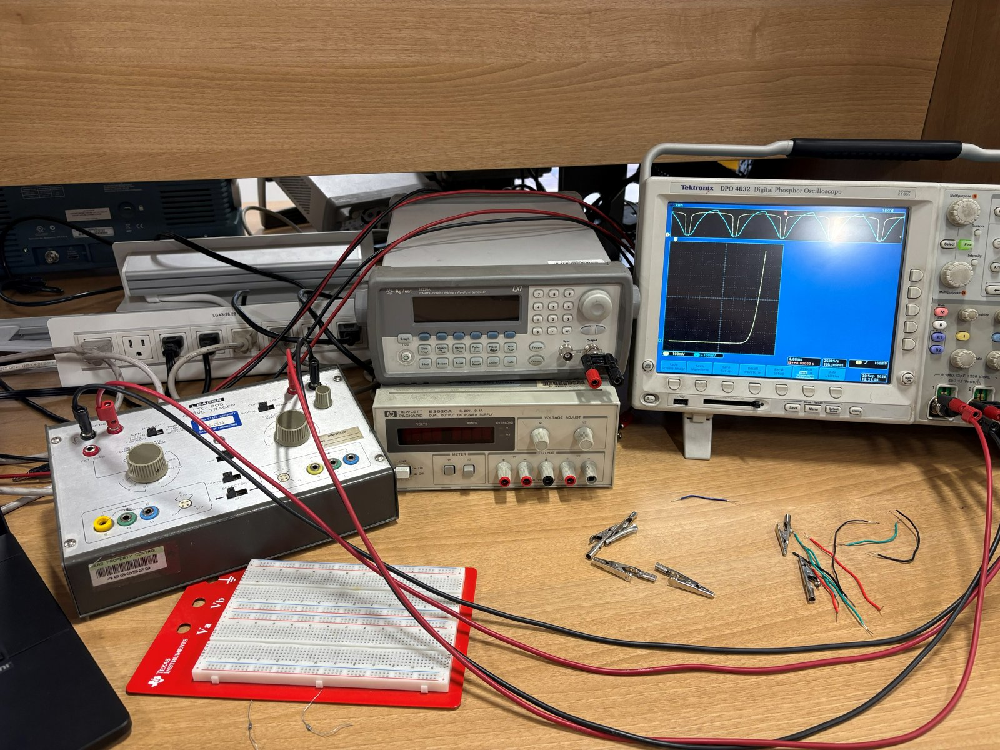
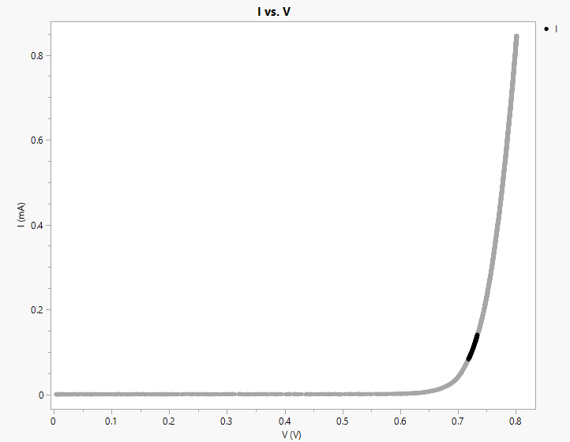
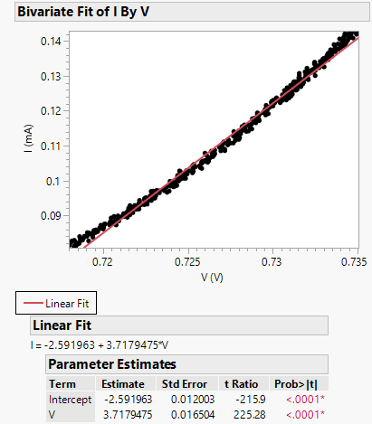
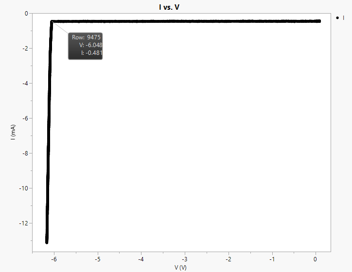
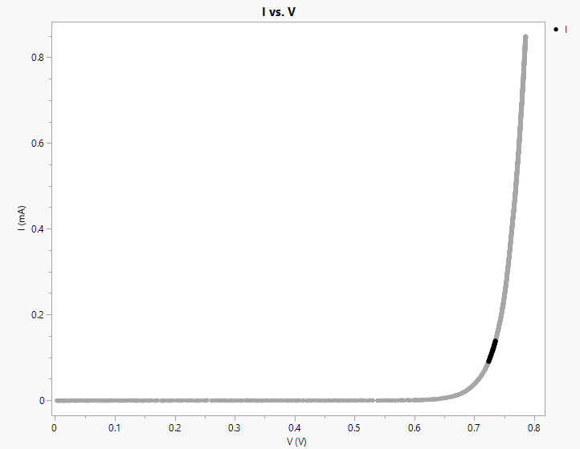
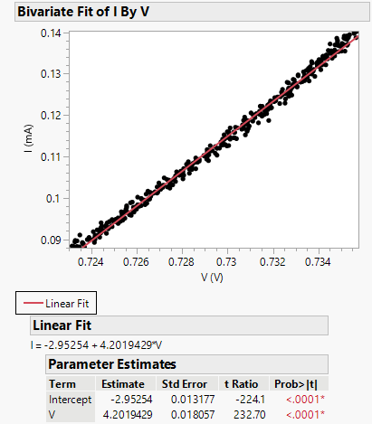
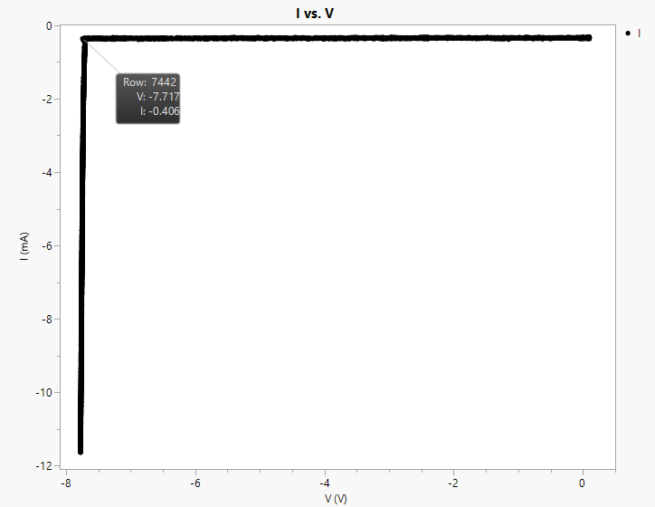
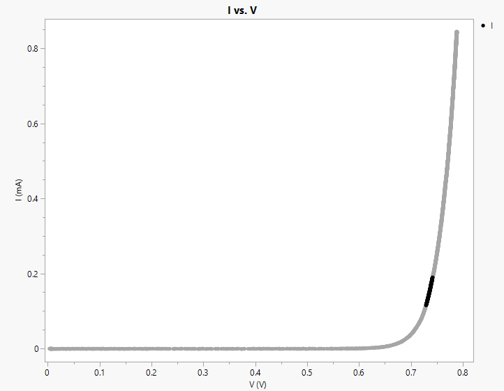
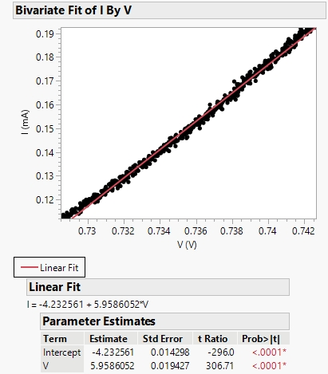

# Device I-V Characterization

**Tools:** Curve tracer, oscilloscope, JMP · **Course / context:** EEE 334 lab, ASU.

I-V measurements on discrete semiconductor devices, and the device parameters extracted from them.

| Device | Status |
|---|---|
| Zener diodes (1N5234, 1N5237, 1N5239) | Below |
| NMOS (CD4007) | In progress |

## Zener diodes: turn-on and breakdown voltage

### Goal

Measure the forward and reverse I-V curves of three Zener diodes and extract the turn-on voltage and breakdown voltage of each.

- **Turn-on voltage:** the voltage where the diode starts to let current flow in the forward direction.
- **Breakdown voltage:** the reverse voltage where the current suddenly jumps up.

### Setup

A LEADER LTC-905 curve tracer sweeps the voltage across the diode. It sends the voltage to the X input and the current to the Y input of a Tektronix DPO4032 oscilloscope in XY mode, which draws the I-V curve. The scope data was saved as CSV, converted to current with the curve tracer's volts-to-amps table, and plotted in JMP.

| Setting | Forward bias | Reverse bias |
|---|---|---|
| Sweep voltage | 10 V | 20 V |
| Polarity | Diode forward | Diode backward |
| Scope CH1 (voltage, X) | 100 mV/div | 1 V/div |
| Scope CH2 (current, Y) | 100 mV/div | 1 V/div |
| Origin | Lower left | Upper right |

The turn-on voltage is the X-axis intercept of a linear trend line fit at the knee of the forward curve. The breakdown voltage is read at the sharp bend in the reverse curve.

### Results

| Diode | Forward I-V | Trend line at knee | Reverse I-V |
|---|---|---|---|
| 1N5234 |  |  |  |
| 1N5237 |  |  |  |
| 1N5239 |  |  |  |

| Diode | Turn-on voltage | Error vs. 0.7 V | Breakdown voltage | Rated | Error vs. rated |
|---|---:|---:|---:|---:|---:|
| 1N5234 | 0.697 V | 0.43% | 6.05 V | 6.2 V | 2.42% |
| 1N5237 | 0.703 V | 0.43% | 7.72 V | 8.2 V | 5.85% |
| 1N5239 | 0.710 V | 1.43% | 8.88 V | 9.1 V | 2.42% |

% error = |(expected − measured) / expected| × 100

All three turn-on voltages are very close to the expected 0.7 V. The breakdown voltages came in a little below the rated values, which may be because the diodes are rated at a higher current than the current used in this test.

## Files

| File | Purpose |
|---|---|
| `plots/` | JMP I-V plots and trend-line fits, curve tracer setup photo |
