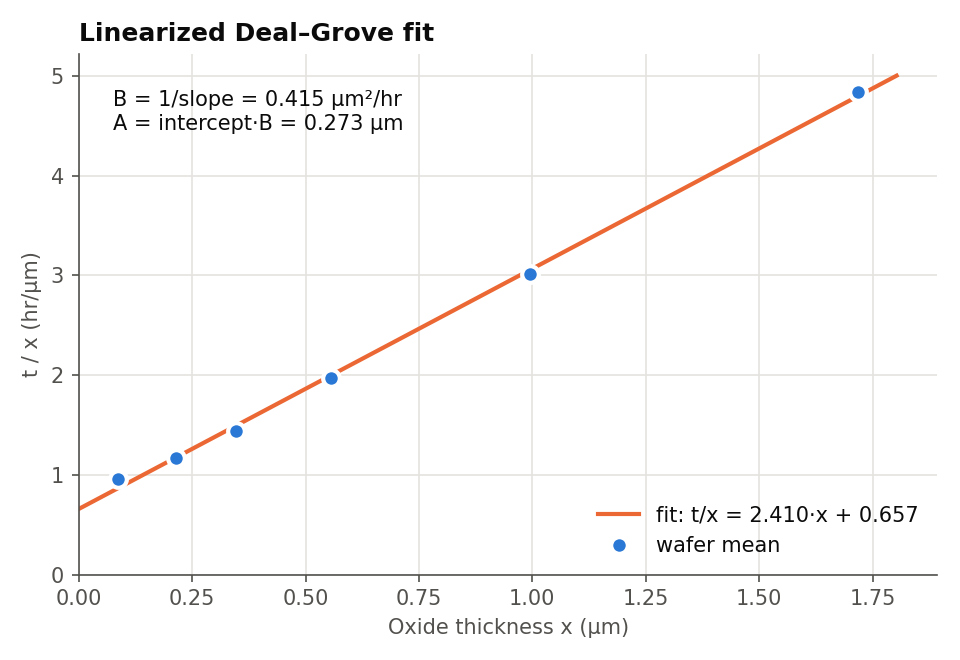
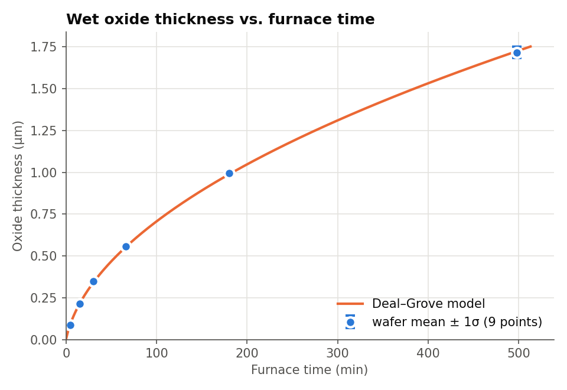
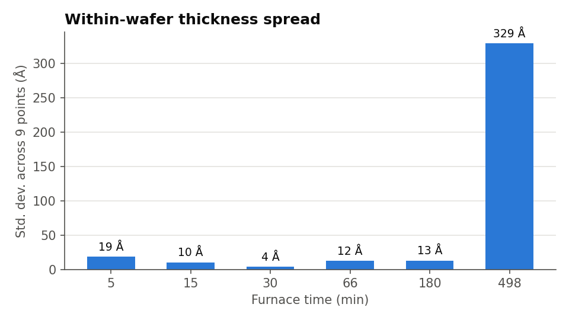
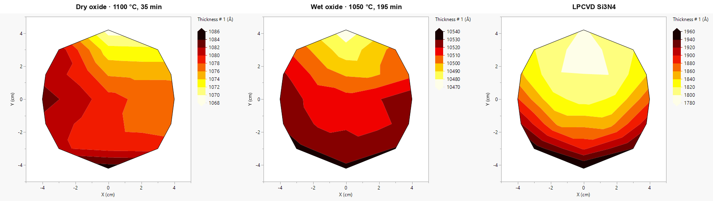

# Wet Thermal Oxidation: Deal–Grove Fit and Film Uniformity

**Tools:** Python (NumPy, Matplotlib), JMP · **Course / context:** EEE 435 (Fundamentals of CMOS and MEMS Processing), ASU. This was a group lab. This writeup covers my part, the data analysis.

## Goal

Extract Deal–Grove rate constants from real furnace data for wet oxidation of silicon, check how well the model predicts thickness over a 100× range of times, and compare the thickness and optical uniformity of thermal oxide against LPCVD silicon nitride.

## Data

All data is the **course-provided dataset** from the ASU NanoFab Tystar furnace. My own measurements are in a separate lab. The analysis, fits and figures here are mine.

| File | Contents |
|---|---|
| [`data/oxide_thickness_vs_time.csv`](data/oxide_thickness_vs_time.csv) | Wet oxide thickness (Å) at 9 points per wafer, measured by spectral reflectance (Filmetrics F20), for 6 furnace times from 5 to 498 min |
| [`data/refractive_index_632nm.csv`](data/refractive_index_632nm.csv) | Refractive index at 632.8 nm at 21 points per wafer for dry oxide, wet oxide and LPCVD nitride, measured by spectroscopic ellipsometry (Woollam RC2) |

The furnace recipe used N₂ purges and ramps, a 1 h dry O₂ step at 800 °C, a ramp to 1050 °C, and then wet oxidation (O₂ at 6 slm, N₂/H₂O at 450 sccm).

## Analysis

The Deal–Grove model, x² + A·x = B·(t + τ), becomes a straight line when rearranged:

```
t / x = (1/B)·x + A/B
```

A linear fit of t/x against x therefore gives **B = 1/slope** and **A = intercept·B**. The offset τ accounts for oxide already on the wafer before the run. I assumed a 20 Å native oxide (x₀ = 0.002 µm), so τ = (x₀² + A·x₀)/B.

[`analysis/deal_grove_fit.py`](analysis/deal_grove_fit.py) reproduces everything below from the CSV:

```bash
pip install numpy matplotlib
python analysis/deal_grove_fit.py
```

## Results

### Rate constants



| Constant | Value |
|---|---|
| B (parabolic) | **0.415 µm²/hr** |
| A | **0.273 µm** |
| B/A (linear) | 1.52 µm/hr |
| τ (20 Å native oxide) | 1.32 × 10⁻³ hr ≈ 4.8 s |

All six wafers fall on the line. τ is a few seconds, which is negligible against even the 5-minute run.

### Model vs. measurement



| Furnace time (min) | Measured mean (µm) | Deal–Grove (µm) | Error |
|---|---|---|---|
| 5   | 0.0874 | 0.0954 | −8.4% |
| 15  | 0.2143 | 0.2142 | +0.0% |
| 30  | 0.3469 | 0.3397 | +2.1% |
| 66  | 0.5572 | 0.5532 | +0.7% |
| 180 | 0.9949 | 0.9879 | +0.7% |
| 498 | 1.7171 | 1.7246 | −0.4% |

From 15 minutes on, the model is within about 2%. The 5-minute wafer is 8% thinner than predicted. At that thickness growth is still mostly reaction-limited, so the result is sensitive to the starting oxide and to exactly when the wafer reaches full temperature and gas flow. A few tens of seconds of delay is a large fraction of a 5-minute run.

### Thickness uniformity



Uniformity is best in the middle of the range: σ ≈ 4 Å at 30 minutes, which is about 0.1% of the thickness. At both ends it degrades to roughly 2%: 19 Å on an 874 Å film at 5 minutes, and 329 Å on a 17,170 Å film at 498 minutes. On the shortest run, small differences in the native oxide and in when growth starts are a large fraction of the film. On the longest run, small temperature or gas-flow gradients across the wafer have about 8 hours to add up.

### Thermal oxide vs. LPCVD nitride



Wafer thickness maps were made with JMP's contour plot.

| Film | n at 632.8 nm (mean) | Std. dev. across 21 points | Thickness range across wafer |
|---|---|---|---|
| Dry oxide | 1.4598 | 3.4 × 10⁻⁵ | ~1068–1086 Å (~1.7%) |
| Wet oxide | 1.4573 | 1.3 × 10⁻⁵ | ~10470–10540 Å (~0.7%) |
| LPCVD Si₃N₄ | 2.3027 | 1.4 × 10⁻³ | ~1780–1960 Å (~10%) |

Both oxides have n ≈ 1.46, as expected for thermal SiO₂. The wet oxide has the more uniform thickness, but uniformity is not the same as film quality: dry oxide is still the denser, lower-defect film used for gate dielectrics. The nitride is about 100× less uniform in index and shows a clear top-to-bottom thickness gradient. Thermal oxide is *grown* by consuming the silicon surface, so it is largely self-limiting. LPCVD *deposits* the film from the gas phase, so depletion of the precursor across the wafer and along the boat turns directly into thickness variation.

## What I learned

- The linearized t/x vs. x fit is a simple, robust way to get Deal–Grove constants from a handful of wafers, and the model holds to about 2% from 0.2 to 1.7 µm of oxide.
- Check the units in τ. Å, µm and hours all appear in one expression, and a slip in converting x₀ changes τ by 100×. Here τ is small either way, so it barely changed the predictions.
- Grown films and deposited films behave differently: thermal oxide is self-limiting and uniform, while LPCVD uniformity depends on gas transport.
- Deal–Grove works on flat wafers. My 2D TCAD study, [Thermal Oxidation of an Etched Si Fin](../../tcad-simulations/si-fin-thermal-oxidation), shows where the planar picture breaks down on narrow features.

## Files

| File | Purpose |
|---|---|
| `data/` | Course thickness and refractive-index data as CSV |
| [`analysis/deal_grove_fit.py`](analysis/deal_grove_fit.py) | Averages the wafers, fits Deal–Grove, prints the comparison table and writes the plots |
| `plots/` | Fit, model-vs-measured, uniformity and wafer-map figures |
