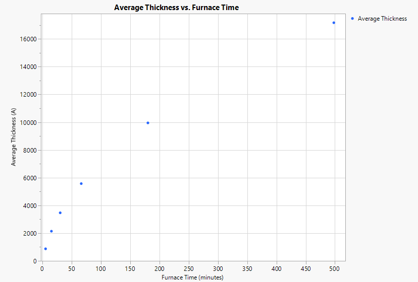
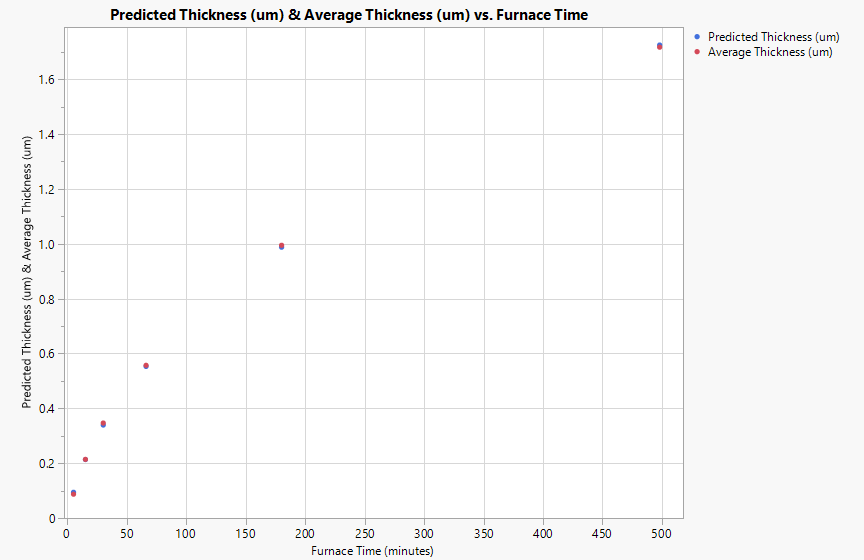

# Wet Thermal Oxidation: Deal–Grove Fit and Film Uniformity

**Tools:** JMP · **Course / context:** EEE 435 (Fundamentals of CMOS and MEMS Processing), ASU. This was a group lab. This writeup covers my part, the data analysis.

## Goal

Find the Deal–Grove A and B constants from oxide thickness vs. furnace time, check the model against the measured thickness, and compare the refractive index and uniformity of dry oxide, wet oxide and LPCVD nitride films.

## Data

The data is the course-provided dataset from the ASU NanoFab furnace runs:

- Wet oxide thickness at 9 points per wafer, measured with a Filmetrics F20, for 6 furnace times.
- Thickness maps and refractive index at 21 points per wafer for dry oxide, wet oxide and LPCVD nitride, from Woollam RC2 ellipsometry.

The same data is also in [`data/`](data) as CSV.

## Oxide growth: A and B constants

### Measured thickness

| Furnace time (min) | 1 (Å) | 2 (Å) | 3 (Å) | 4 (Å) | 5 (Å) | 6 (Å) | 7 (Å) | 8 (Å) | 9 (Å) | Average (Å) | Std. dev. (Å) |
|---:|---:|---:|---:|---:|---:|---:|---:|---:|---:|---:|---:|
| 5   | 910.9   | 867.7   | 869.1   | 860.4   | 858.3   | 865.4   | 863.4   | 866.7   | 900.6   | 873.6   | 18.7  |
| 15  | 2125.4  | 2131.8  | 2140.1  | 2146.9  | 2158.4  | 2146.5  | 2136.0  | 2147.0  | 2151.3  | 2142.6  | 10.2  |
| 30  | 3471.1  | 3467.8  | 3466.0  | 3472.6  | 3464.4  | 3462.2  | 3470.5  | 3474.0  | 3468.7  | 3468.6  | 3.9   |
| 66  | 5554.8  | 5569.9  | 5580.1  | 5580.5  | 5579.9  | 5549.8  | 5578.3  | 5584.0  | 5574.5  | 5572.4  | 12.2  |
| 180 | 9970.0  | 9958.7  | 9946.5  | 9942.5  | 9928.3  | 9959.5  | 9953.0  | 9945.4  | 9935.0  | 9948.8  | 13.0  |
| 498 | 16925.5 | 17032.0 | 17179.0 | 17201.0 | 17117.5 | 16774.5 | 16947.0 | 17506.5 | 17852.0 | 17170.6 | 329.2 |

Thickness uniformity drops considerably between the 180 and 498 minute runs: the standard deviation jumps from 13 Å to 329 Å.



### Linear fit

Plotting t/x (hr/µm) against x (µm) gives a straight line with slope 1/B and intercept A/B.


```
t/x = 0.6573 + 2.4100·x

B = 1 / slope        = 0.415 µm²/hr
A = intercept × B    = 0.272 µm
```

The time offset τ comes from the initial oxide thickness x₀. I assumed a native oxide of 20 Å, which is x₀ = 0.002 µm:

```
τ = (x₀² + A·x₀) / B = 1.32 × 10⁻³ hr ≈ 4.8 s
```

### Predicted vs. measured

```
x(t) = [ −A + √(A² + 4B(t + τ)) ] / 2      (t in hours, x in µm)
```



| Furnace time (min) | Average thickness (µm) | Predicted thickness (µm) | Error |
|---:|---:|---:|---:|
| 5   | 0.0874 | 0.0956 | −9.40% |
| 15  | 0.2143 | 0.2144 | −0.07% |
| 30  | 0.3469 | 0.3400 | +1.99% |
| 66  | 0.5572 | 0.5536 | +0.65% |
| 180 | 0.9949 | 0.9883 | +0.66% |
| 498 | 1.7171 | 1.7251 | −0.47% |

Error = (average − predicted) / average.

The fit is good: the model is within 2% of the measured thickness at every time except 5 minutes. τ is only a few seconds, so calculating it after A and B doesn't affect the fit.

## Ellipsometry


Wafer thickness maps were made with JMP's contour plot.

The refractive index at λ = 0.6328 µm comes from the Cauchy model, n(λ) = A + B/λ² + C/λ⁴, evaluated at each measurement position. Here A, B and C are Cauchy coefficients, not the Deal–Grove constants.

| | Dry oxide | Wet oxide | LPCVD nitride |
|---|---:|---:|---:|
| Mean n | 1.4598 | 1.4573 | 2.3027 |
| Std. dev. | 3.40 × 10⁻⁵ | 1.34 × 10⁻⁵ | 1.43 × 10⁻³ |

<details>
<summary>Refractive index at all 21 positions</summary>

| Position | Dry oxide | Wet oxide | LPCVD nitride |
|---:|---:|---:|---:|
| 1  | 1.4598452 | 1.4573363 | 2.3021540 |
| 2  | 1.4597765 | 1.4573376 | 2.3027921 |
| 3  | 1.4597990 | 1.4573376 | 2.3029286 |
| 4  | 1.4598215 | 1.4573376 | 2.3009166 |
| 5  | 1.4597753 | 1.4573613 | 2.2997796 |
| 6  | 1.4598202 | 1.4573376 | 2.3025913 |
| 7  | 1.4598215 | 1.4573132 | 2.3032161 |
| 8  | 1.4597759 | 1.4573388 | 2.3031046 |
| 9  | 1.4597316 | 1.4573139 | 2.3034678 |
| 10 | 1.4597309 | 1.4573382 | 2.3031419 |
| 11 | 1.4597765 | 1.4573376 | 2.3028913 |
| 12 | 1.4597540 | 1.4573376 | 2.3013417 |
| 13 | 1.4597072 | 1.4573394 | 2.3007418 |
| 14 | 1.4597765 | 1.4573388 | 2.3017915 |
| 15 | 1.4597765 | 1.4573132 | 2.3020169 |
| 16 | 1.4597753 | 1.4573376 | 2.3025423 |
| 17 | 1.4597984 | 1.4573151 | 2.3044422 |
| 18 | 1.4597547 | 1.4573170 | 2.3055169 |
| 19 | 1.4597528 | 1.4573139 | 2.3023048 |
| 20 | 1.4597534 | 1.4573157 | 2.3029538 |
| 21 | 1.4597528 | 1.4573170 | 2.3057165 |

</details>

LPCVD nitride has the largest refractive index but is also the least uniform. Dry and wet oxide have about the same refractive index, but wet oxide is slightly more uniform.

**Related:** [Thermal Oxidation of an Etched Si Fin](../../tcad-simulations/si-fin-thermal-oxidation), a 2D TCAD simulation of wet oxidation on a narrow fin.

## Files

| File | Purpose |
|---|---|
| `data/` | Thickness and refractive-index data as CSV |
| `plots/` | JMP figures: thickness vs. time, linear fit, predicted vs. measured, wafer maps |
