# Diode & MOSFET I-V Characterization

**Tools:** Curve tracer, oscilloscope, DMM, JMP, LTspice · **Course / context:** EEE 334 lab, ASU.

I-V measurements on discrete semiconductor devices, and the device parameters extracted from them.

  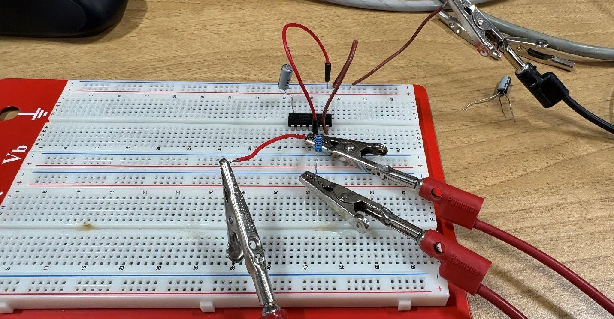
  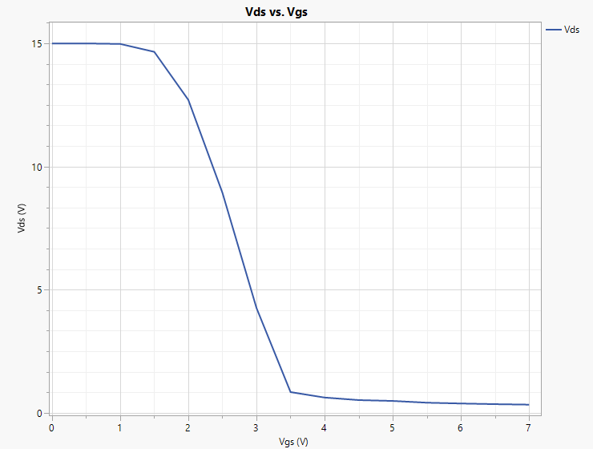
   <em>The CD4007 NMOS common-source amplifier on the breadboard, and its measured transfer characteristic.</em>

## Key results

- **Vt = 0.872 V** and **kn'(W/L) = 0.436 mA/V²** for the CD4007 NMOS from a √iD vs. VGS fit, with λ = 0.00593 V⁻¹ (VA ≈ 169 V).
- Common-source gain at Q of **−8.48 V/V** measured vs. −7.59 V/V in LTspice with the measured parameters. Refitting over the operating current range brought the hand-calculated gain within **2.5%** of the measurement.
- Zener turn-on of **0.70 to 0.71 V**, and breakdown within **6%** of rated for all three diodes.

## Devices

| Device | Parameters extracted |
|---|---|
| [Zener diodes (1N5234, 1N5237, 1N5239)](#zener-diodes-turn-on-and-breakdown-voltage) | Turn-on voltage, breakdown voltage |
| [NMOS (CD4007)](#nmos-cd4007-square-law-parameters-and-common-source-amplifier) | Vt, kn'(W/L), ro, λ / VA, gm, common-source transfer curve and gain |

## Zener diodes: turn-on and breakdown voltage

### Goal

Measure the forward and reverse I-V curves of three Zener diodes and extract the turn-on voltage and breakdown voltage of each.

- **Turn-on voltage:** the voltage where the diode starts to let current flow in the forward direction.
- **Breakdown voltage:** the reverse voltage where the current suddenly jumps up.

### Setup

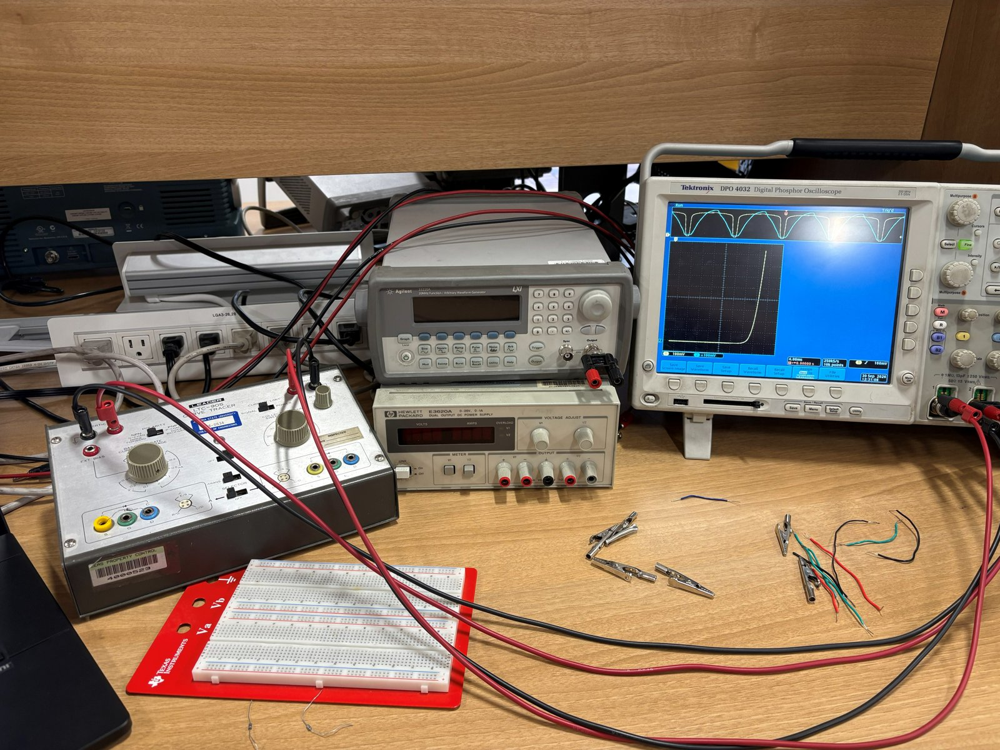

A LEADER LTC-905 curve tracer sweeps the voltage across the diode. It sends the voltage to the X input and the current to the Y input of a Tektronix DPO4032 oscilloscope in XY mode, which draws the I-V curve. The scope data was saved as CSV, converted to current with the curve tracer's volts-to-amps table, and plotted in JMP.

| Setting | Forward bias | Reverse bias |
|---|---|---|
| Sweep voltage | 10 V | 20 V |
| Polarity | Diode forward | Diode backward |
| Scope CH1 (voltage, X) | 100 mV/div | 1 V/div |
| Scope CH2 (current, Y) | 100 mV/div | 1 V/div |
| Origin | Lower left | Upper right |

The turn-on voltage is the X-axis intercept of a linear trend line fit at the knee of the forward curve. The breakdown voltage is read at the sharp bend in the reverse curve.

### Results

| Diode | Forward I-V | Trend line at knee | Reverse I-V |
|---|---|---|---|
| 1N5234 | 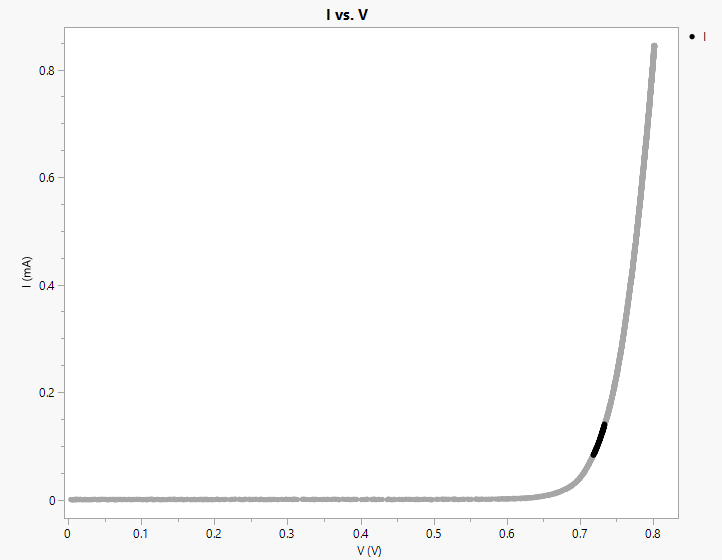 | 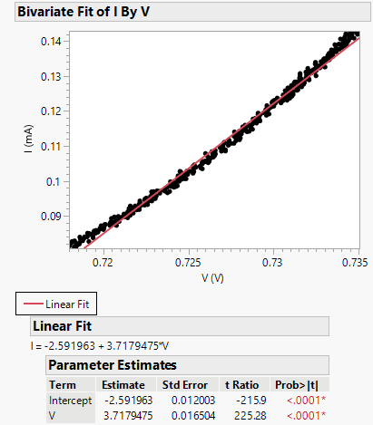 |  |
| 1N5237 | 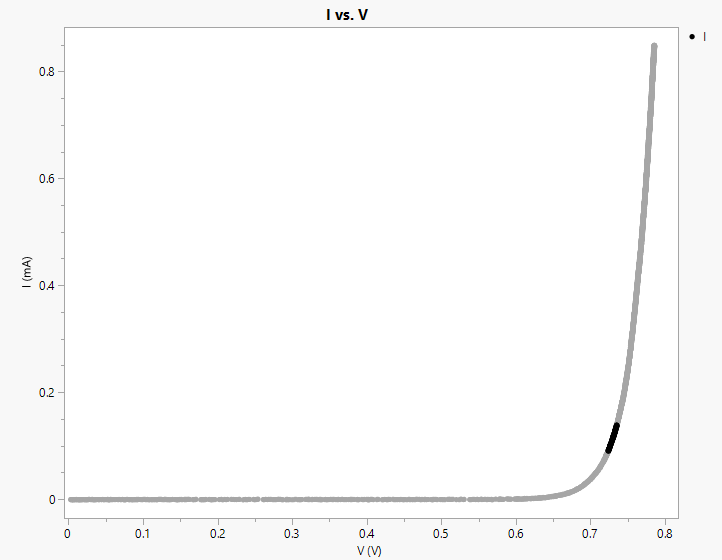 | 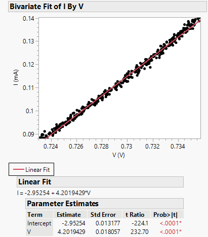 | 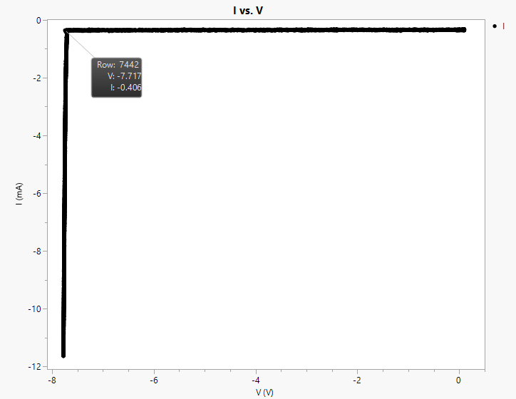 |
| 1N5239 | 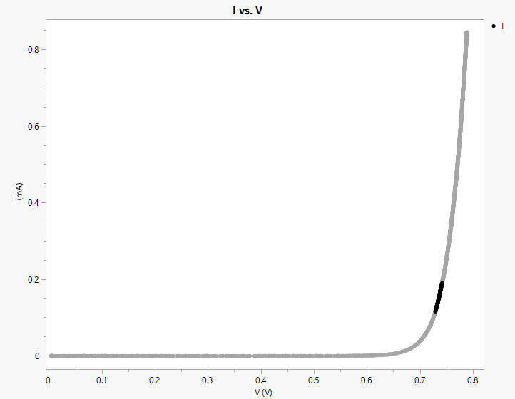 | 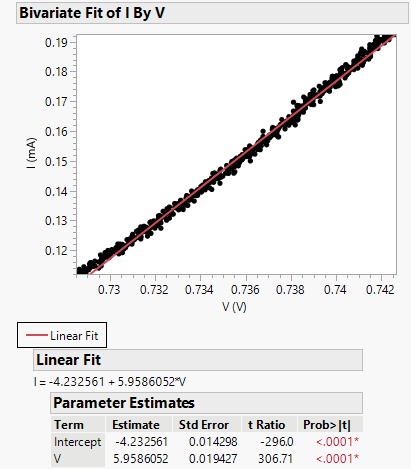 | 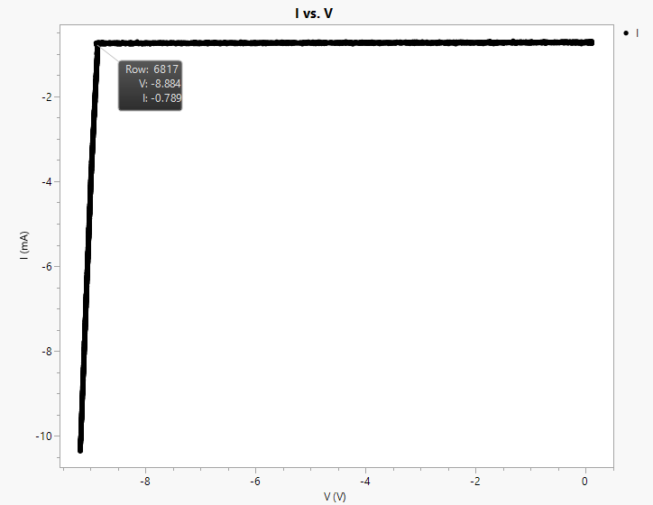 |

| Diode | Turn-on voltage | Error vs. 0.7 V | Breakdown voltage | Rated | Error vs. rated |
|---|---:|---:|---:|---:|---:|
| 1N5234 | 0.697 V | 0.43% | 6.05 V | 6.2 V | 2.42% |
| 1N5237 | 0.703 V | 0.43% | 7.72 V | 8.2 V | 5.85% |
| 1N5239 | 0.710 V | 1.43% | 8.88 V | 9.1 V | 2.42% |

% error = |(expected − measured) / expected| × 100

All three turn-on voltages are very close to the expected 0.7 V. The breakdown voltages came in a little below the rated values, which may be because the diodes are rated at a higher current than the current used in this test.

## NMOS (CD4007): square-law parameters and common-source amplifier

### Goal

Measure the I-V characteristics of the NMOS transistor in a CD4007 array and extract its threshold voltage Vt, transconductance parameter kn'(W/L), output resistance ro, channel-length modulation λ and Early voltage VA, and transconductance gm. Then use the NMOS in a common-source amplifier, find the transfer characteristic and the gain around the Q point, and compare it to an LTspice simulation built from the measured parameters.

### Setup

The NMOS on pins 3, 4 and 5 of the CD4007 was used for every measurement, with the substrate (pin 7) grounded and a 1 µF capacitor from pin 14 to ground. Drain current was measured with a Keithley DMM as the ammeter.

| Measurement | Bias | Sweep |
|---|---|---|
| Vt and kn'(W/L) | Gate tied to drain (VGS = VDS) | 0 to 8 V in 0.5 V steps |
| ro and λ | VGS = 3 V, then 5 V | VDS 0 to 7 V in 0.5 V steps |
| gm | VDS = 10 V | VGS 2 to 7 V in 0.5 V steps |
| Common-source transfer curve | VDD = 15 V, RD = 10 kΩ (9.94 kΩ measured) | VGS 0 to 7 V in 0.5 V steps |

### Vt and kn'(W/L)

With the gate tied to the drain, VDS = VGS is always greater than VGS − Vt, so the NMOS is in saturation at every point above threshold. In saturation iD = ½kn'(W/L)(VGS − Vt)², so √iD vs. VGS is a straight line with slope √(½kn'(W/L)) and x-intercept Vt.

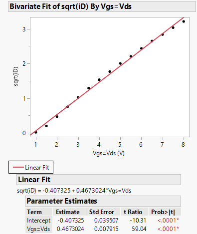

The fit (slope 0.467 √mA/V, intercept −0.407 √mA) gives **Vt = 0.872 V** and **kn'(W/L) = 2·slope² = 0.436 mA/V²**.

These are 27.3% and 30.9% off the lab manual's default model values (Vt = 1.2 V, kn'(W/L) = 111 µA/V² × 30/10 = 0.333 mA/V²). Some difference is expected because CD4007 parameters vary from part to part. A larger part comes from the fit: the √iD curve is not perfectly straight. Its slope is about 0.55 √mA/V between 1.5 and 3 V but drops to about 0.36 √mA/V above 6 V, where mobility degradation and source/drain series resistance limit the current. One line through the whole range lowers the slope and the x-intercept. Fitting only the 1.5 to 3 V points gives Vt = 1.14 V and kn'(W/L) = 0.60 mA/V², much closer to the manual's Vt.

### ro, λ and VA

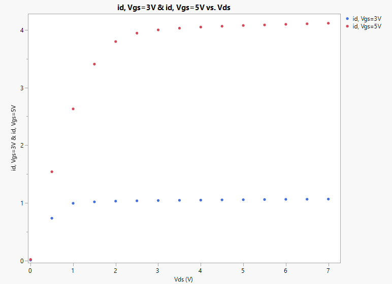

| VGS = 3 V saturation fit | VGS = 5 V saturation fit |
|---|---|
| 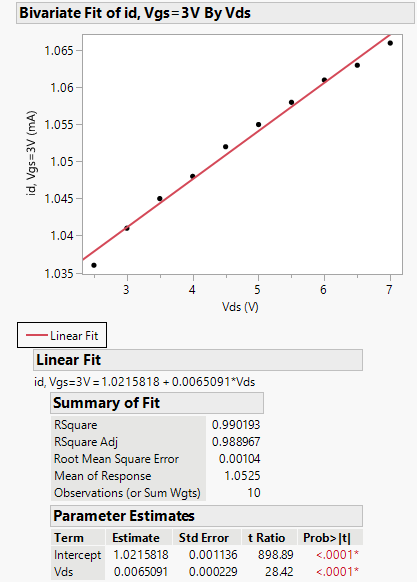 | 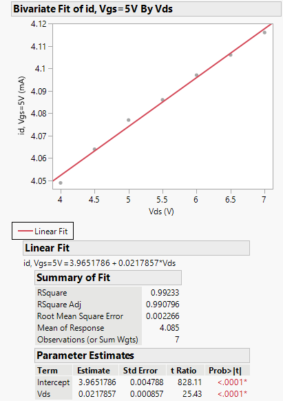 |

ro is the inverse of the saturation slope, and VA is the trend line's x-intercept, with λ = 1/|VA|.

| | VGS = 3 V | VGS = 5 V | Average |
|---|---:|---:|---:|
| ro | 153.6 kΩ | 45.9 kΩ | |
| VA | 157.0 V | 182.0 V | 169.5 V |
| λ | 0.00637 V⁻¹ | 0.00549 V⁻¹ | **0.00593 V⁻¹** |

ro drops at higher VGS because ro = 1/(λ·ID): the saturation current rose about 3.9× and ro fell about 3.3×. Using the average λ, the calculated ro values are 165.0 kΩ and 42.5 kΩ, within 6.9% and 8.0% of the fits. Ideally VA depends only on channel length, so the 15% spread between the two Early voltages is what causes those errors. One likely cause is self-heating at VGS = 5 V (up to about 29 mW at VDS = 7 V), which lowers mobility as VDS rises and flattens the curve.

The average λ is 40.7% below the manual's 0.01 V⁻¹. A small λ (large VA) is consistent with the CD4007's long 10 µm channel. The saturation slopes are tiny (about 6.5 µA/V at VGS = 3 V), so ammeter resolution, supply drift or heating changes λ by a large percentage, which makes it the least precise of the extracted parameters.

### gm

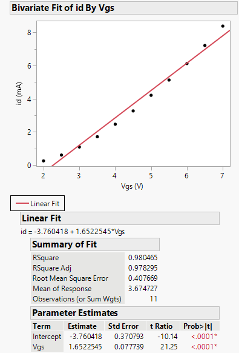

At VDS = 10 V the NMOS stays in saturation over the whole sweep. iD rises quadratically, so gm = 2ID/(VGS − Vt) grows linearly with overdrive, from 0.44 mA/V at VGS = 2 V to 2.74 mA/V at 7 V. The average calculated gm is **1.708 mA/V**, 3.3% above the **1.652 mA/V** slope of the trend line. A single line through a curved plot gives an average gm, not the gm at a specific bias point.

Channel-length modulation is also consistent across sections. At VGS = 3 V, iD was 1.086 mA at VDS = 10 V and 1.042 mA at VDS = 3 V. Scaling the 3 V current by (1 + 10λ)/(1 + 3λ) with the measured λ gives 1.085 mA, within 0.1%.

### Common-source amplifier

| Built circuit | LTspice model with the measured parameters |
|---|---|
|  | 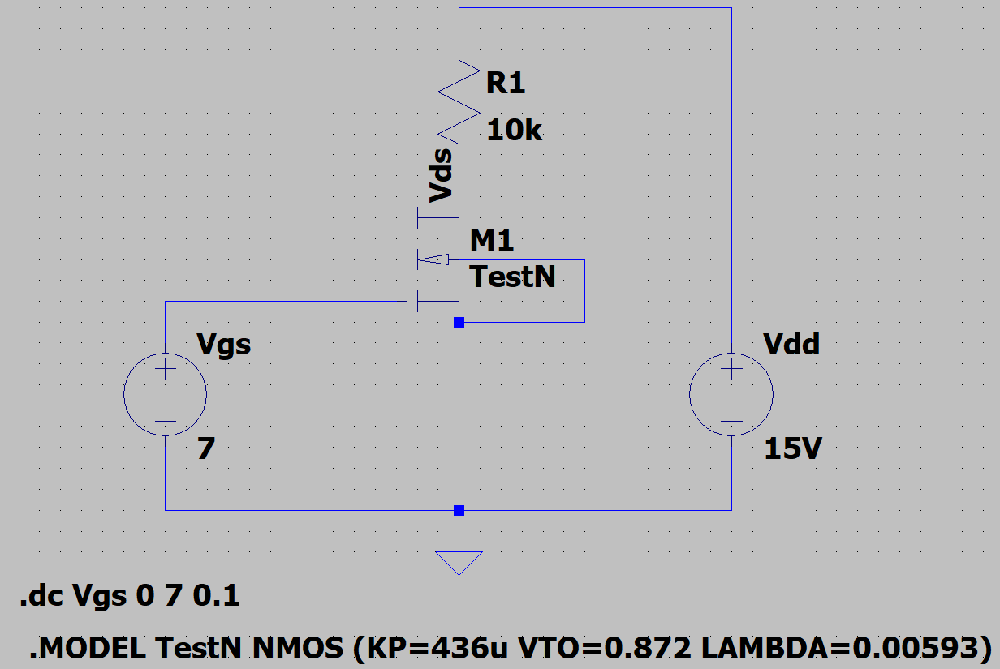 |

The transfer curve shows all three regions. Below about 1 V the NMOS is off and VDS = VDD = 15 V (point A). Between about 1.5 and 3.3 V it is in saturation and VDS drops steeply. Above about 3.3 V (point B, where VDS = VGS − Vt) it enters triode and VDS flattens toward 0.33 V. Following Sedra and Smith, the Q point was placed midway between A and B in output, at VDS = 8.5 V, for the largest symmetric swing.

| Measured: linear fit through the 2, 2.5 and 3 V points | LTspice: full sweep and slope at Q |
|---|---|
| 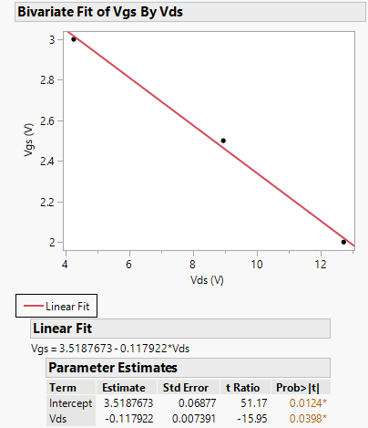 | 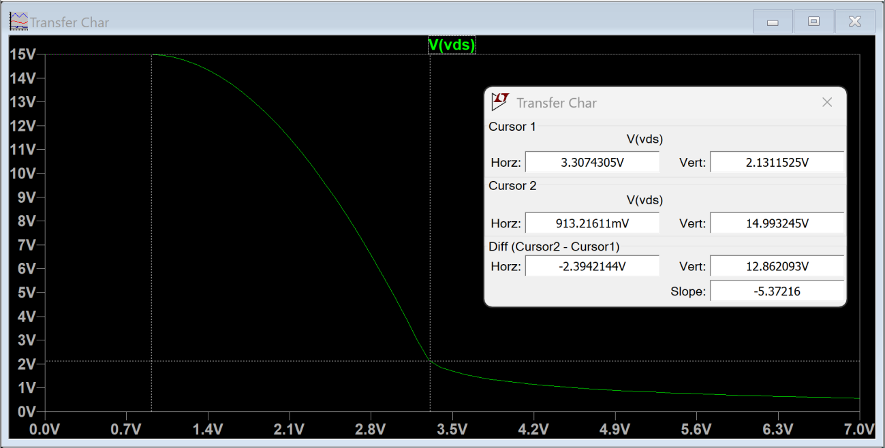 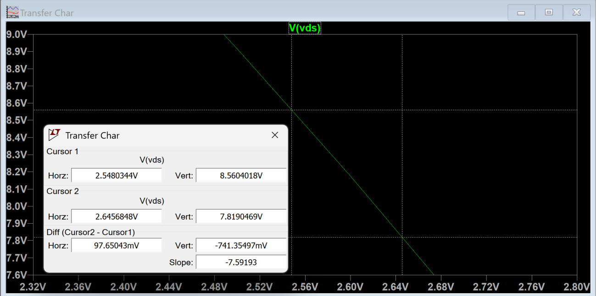 |

| | Measured | LTspice | Difference |
|---|---:|---:|---:|
| VGS at Q | 2.52 V | 2.548 V | 1.2% |
| VDS at Q | 8.5 V | 8.562 V | 0.7% |
| Gain at Q (dVDS/dVGS) | **−8.48 V/V** | −7.59 V/V | 11.7% |

The negative gain shows the common-source amplifier is inverting. The three measured points are evenly spaced around Q, and for a parabola the chord between symmetric points equals the tangent at the center, so the measured slope is a good estimate of the small-signal gain.

The hand calculation Av = −kn'(W/L)(VGS − Vt)RD with the parameters above gives −7.13 V/V, 19.0% below the measurement. LTspice and the calculation both use those parameters and both underestimate the gain. The Q point sits at only about 0.65 mA, in the low-current part of the curve where the full-range fit underestimates kn'(W/L). With the low-current parameters instead (Vt = 1.14 V, kn'(W/L) = 0.60 mA/V²), the calculated gain is −8.27 V/V, within 2.5% of the measurement.

### Summary

| Parameter | Value |
|---|---:|
| Vt | 0.872 V |
| kn'(W/L) | 0.436 mA/V² |
| λ (VA) | 0.00593 V⁻¹ (169 V) |
| ro at VGS = 3 V / 5 V | 154 kΩ / 46 kΩ |
| gm at VDS = 10 V (average) | 1.65 to 1.71 mA/V |
| Common-source gain at Q | −8.48 V/V measured, −7.59 V/V LTspice |

The square-law model described the device well enough that the calculated ro, gm and Q point came within about 1 to 8% of the measurements. The largest errors came from the extracted parameters, not the measurements: a single Vt and kn'(W/L) cannot fit the whole 0 to 8 V range, because mobility degradation and series resistance reduce the current at high VGS. The main takeaway is that device parameters should be extracted over the same current range the circuit will operate in. With the parameters refit over the low-current range near the Q point, the calculated gain matched the measurement within 2.5%.

Measured data

**Vt and kn'(W/L)** (VGS = VDS)

| VGS = VDS (V) | 0 | 0.5 | 1 | 1.5 | 2 | 2.5 | 3 | 3.5 | 4 | 4.5 | 5 | 5.5 | 6 | 6.5 | 7 | 7.5 | 8 |
|---|---|---|---|---|---|---|---|---|---|---|---|---|---|---|---|---|---|
| iD (mA) | 0 | 0 | 0.00021 | 0.0394 | 0.220 | 0.565 | 1.042 | 1.663 | 2.350 | 3.130 | 4.015 | 4.871 | 5.931 | 7.030 | 8.055 | 9.224 | 10.33 |

**ro and λ**

| VDS (V) | 0 | 0.5 | 1 | 1.5 | 2 | 2.5 | 3 | 3.5 | 4 | 4.5 | 5 | 5.5 | 6 | 6.5 | 7 |
|---|---|---|---|---|---|---|---|---|---|---|---|---|---|---|---|
| iD at VGS = 3 V (mA) | 0.00725 | 0.734 | 0.993 | 1.0175 | 1.030 | 1.036 | 1.041 | 1.045 | 1.048 | 1.052 | 1.055 | 1.058 | 1.061 | 1.063 | 1.066 |
| iD at VGS = 5 V (mA) | 0.0185 | 1.540 | 2.630 | 3.407 | 3.798 | 3.944 | 4.000 | 4.030 | 4.049 | 4.064 | 4.077 | 4.086 | 4.097 | 4.106 | 4.116 |

**gm** (VDS = 10 V)

| VGS (V) | 2 | 2.5 | 3 | 3.5 | 4 | 4.5 | 5 | 5.5 | 6 | 6.5 | 7 |
|---|---|---|---|---|---|---|---|---|---|---|---|
| iD (mA) | 0.246 | 0.599 | 1.086 | 1.704 | 2.461 | 3.264 | 4.208 | 5.130 | 6.123 | 7.215 | 8.386 |
| gm = 2ID/(VGS − Vt) (mA/V) | 0.435 | 0.735 | 1.020 | 1.296 | 1.573 | 1.798 | 2.038 | 2.216 | 2.387 | 2.563 | 2.736 |

**Common-source transfer characteristic** (VDD = 15 V, RD = 9.94 kΩ)

| VGS (V) | 0 | 0.5 | 1 | 1.5 | 2 | 2.5 | 3 | 3.5 | 4 | 4.5 | 5 | 5.5 | 6 | 6.5 | 7 |
|---|---|---|---|---|---|---|---|---|---|---|---|---|---|---|---|
| VDS (V) | 15 | 15 | 14.98 | 14.66 | 12.71 | 8.945 | 4.263 | 0.845 | 0.623 | 0.520 | 0.485 | 0.414 | 0.381 | 0.355 | 0.334 |

## Files

| File | Purpose |
|---|---|
| `plots/` | JMP I-V plots and fits, LTspice schematic and sweeps, curve tracer and breadboard photos |
