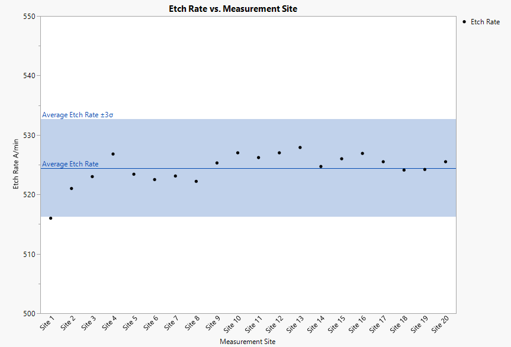
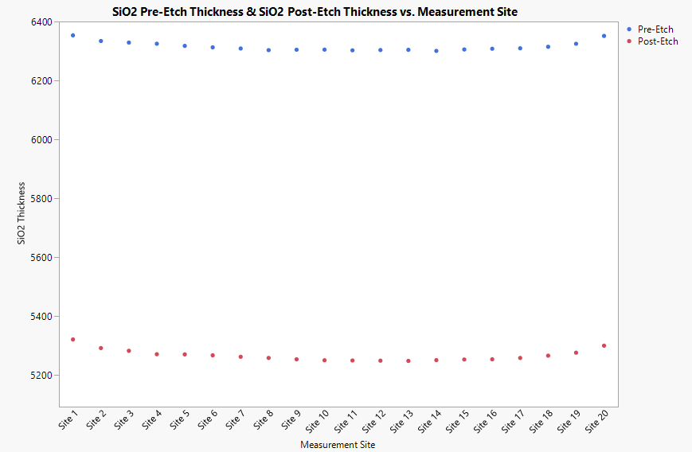

# SiO₂ RIE: Etch-Rate Uniformity

**Tools:** JMP · **Course / context:** EEE 435 (Fundamentals of CMOS and MEMS Processing), ASU. This was a group lab. This writeup covers my part, the data analysis.

  
   <em>SiO₂ etch rate at 20 sites, with the average and the ±3σ band.</em>

## Key results

- Average etch rate **524 Å/min** with **3σ = 8.2 Å/min**, about **1.6%** of the mean, so the etch was fairly uniform across the wafer.
- Slowest at the Site 1 edge (**516 Å/min**, just below the lower 3σ limit) and fastest near the center (up to **527.9 Å/min**). The opposite edge, Site 20, etched slightly above average.
- The oxide was a little less uniform after the etch: thickness σ went from **15.8 Å to 19.5 Å**.

## Goal

Find how evenly a CHF₃/O₂ reactive ion etch removed SiO₂ across a wafer: the etch rate at each measurement site, its average and 3σ spread, and which areas etched faster or slower.

## Data

The data is a course-provided dataset from my group's run. It gives the SiO₂ thickness at 20 sites before and after the etch, and the etch rate at each site. The sites run across the wafer from one edge (Site 1) to the opposite edge (Site 20).

Etch conditions from the lab: Plasma-Therm 790 RIE, CHF₃ 40 sccm and O₂ 3 sccm, 40 mTorr, 250 W RF, 2 min.

| | Pre-etch thickness (Å) | Post-etch thickness (Å) | Etch rate (Å/min) |
|---|---:|---:|---:|
| Mean | 6315.89 | 5267.10 | 524.42 |
| Std. dev. | 15.77 | 19.47 | 2.74 |
| Median | 6309.15 | 5260.70 | 525.00 |

All 20 sites

| Site | Pre-etch (Å) | Post-etch (Å) | Etch rate (Å/min) |
|---:|---:|---:|---:|
| 1  | 6353.4 | 5321.5 | 516.0 |
| 2  | 6334.2 | 5292.2 | 521.0 |
| 3  | 6328.9 | 5282.9 | 523.0 |
| 4  | 6325.0 | 5271.4 | 526.8 |
| 5  | 6317.6 | 5270.8 | 523.4 |
| 6  | 6312.6 | 5267.6 | 522.5 |
| 7  | 6308.8 | 5262.6 | 523.1 |
| 8  | 6303.2 | 5258.8 | 522.2 |
| 9  | 6304.6 | 5254.1 | 525.3 |
| 10 | 6304.9 | 5250.9 | 527.0 |
| 11 | 6302.5 | 5250.1 | 526.2 |
| 12 | 6303.5 | 5249.5 | 527.0 |
| 13 | 6304.3 | 5248.6 | 527.9 |
| 14 | 6300.6 | 5251.3 | 524.7 |
| 15 | 6305.5 | 5253.5 | 526.0 |
| 16 | 6307.9 | 5254.2 | 526.9 |
| 17 | 6309.5 | 5258.6 | 525.5 |
| 18 | 6314.6 | 5266.5 | 524.1 |
| 19 | 6324.8 | 5276.5 | 524.2 |
| 20 | 6351.4 | 5300.4 | 525.5 |

The same data is in [`data/etch_rate_by_site.csv`](data/etch_rate_by_site.csv).

## Thickness before and after the etch

The film was thickest at the two edges (Sites 1 and 20) and thinnest near the center, both before and after the etch.

## Etch rate

The etch rate at each site is the thickness removed divided by the 2 min etch time. The average was 524.4 Å/min with a 3σ of 8.2 Å/min, so the etch was fairly uniform across the wafer (3σ is about 1.6% of the mean). The ±3σ band runs from 516.2 to 532.6 Å/min.

The lowest rate was at Site 1 on the wafer edge (516 Å/min), and the highest rates were near the center (up to 527.9 Å/min at Site 13). Site 1 was the only site that stood out, just below the lower 3σ limit of 516.2 Å/min.

The center likely etched faster because the plasma is usually strongest in the middle of the chamber, and the gas supply is often concentrated there. The Site 1 edge may have etched slower because the electric field bends near the wafer edge, so fewer ions reach the surface. However, the opposite edge (Site 20) etched at 525.5 Å/min, slightly above average, so the slow edge was one-sided. The chamber may also be slightly uneven, for example in gas flow or wafer placement.

Because the thick Site 1 edge etched the slowest and the thinner center etched the fastest, the oxide ended up a little less uniform after etching than before: the thickness standard deviation went from 15.8 Å to 19.5 Å.

## Conclusions

- The CHF₃/O₂ etch removed SiO₂ at an average of 524 Å/min with a 3σ of 8.2 Å/min (about 1.6% of the mean), a fairly uniform etch.
- The center etched fastest. Only the Site 1 edge was slow, just below the lower 3σ limit, while the opposite edge was slightly above average, so the chamber may also be slightly uneven.
- Because the thicker edge etched slowest, the film was slightly less uniform after the etch than before.

**Related:** [GaAs RIE: Etch Selectivity & Mask Design](../../tcad-simulations/gaas-rie-etch-selectivity), a TCAD simulation of reactive ion etching through an SiO₂ hard mask.

## Files

| File | Purpose |
|---|---|
| `data/` | Thickness and etch rate at each site as CSV |
| `plots/` | JMP figures: thickness before and after the etch, etch rate with the ±3σ band |
