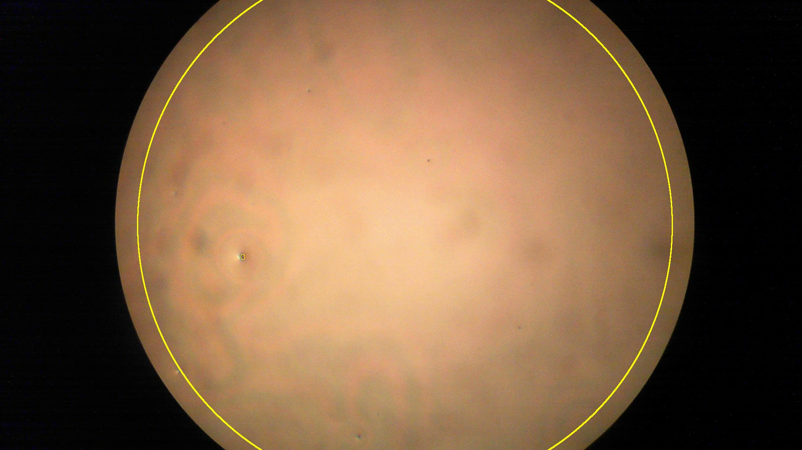
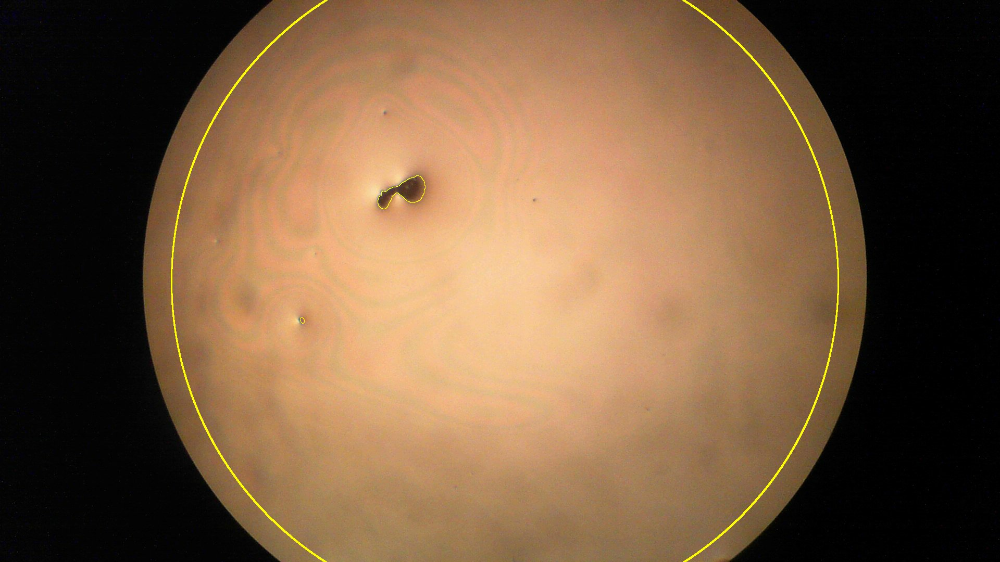

# Spin-Coat Defect Analysis

Automated time-lapse imaging and defect counting for spin-coated films, built for an ASU FURI research project (Fall 2026). The question is how spin process parameters affect when defects first appear in a freshly coated film and how quickly they nucleate and grow afterward.

<p align="center">
  
  
  <br><em>The same shard 30 s and 60 min after the spin stops. Yellow outlines are defects found by the ImageJ macro inside the analysis circle.</em>
</p>

## Pipeline

```
Spin coat shard ──▶ capture/defect_imaging.py ──▶ captures/runXX_shard/*.png + log.csv
                     (camera + Opta-switched lamp,                │
                      photos on a fixed schedule from t = 0)      ▼
                                              analysis/imagej/defect_count.ijm
                                              (flat-field, threshold, count per image)
                                                                  │
                                                                  ▼
                                              defect_count.csv ──▶ JMP DOE model
```

1. **Capture.** [`capture/defect_imaging.py`](capture/defect_imaging.py) drives a USB microscope camera with fixed focus, exposure and white balance, using uncompressed YUY2 frames. It switches the illumination lamp through an Arduino Opta relay. It takes a bare-shard reference, then bursts of 3 photos at set times after the spin stops (30 s up to 60 min). Every frame is logged to CSV with its timing and lamp-on duration. The lamp is only on while shooting, so it doesn't heat the film.
2. **Lamp safety.** [`firmware/opta_lamp_relay`](firmware/opta_lamp_relay) is the Opta firmware. It takes single-character serial commands and has a hardware 30 s auto-off, so a crashed script can't leave the lamp on.
3. **Defect counting.** [`analysis/imagej/defect_count.ijm`](analysis/imagej/defect_count.ijm) keeps the green channel and divides by a heavily blurred copy to flatten uneven lighting. It then thresholds spots darker than their surroundings by a set fraction, filters by size inside a circular region of interest and writes per-image and per-timepoint averaged counts and areas. It also saves a `_check.jpg` overlay for each image so the result can be checked by eye.
4. **Design of experiments.** [`analysis/jmp/defect_doe_design.jsl`](analysis/jmp/defect_doe_design.jsl) generates a full-factorial design with 4 center points:
   - **Factors:** covered/uncovered, ramp time (2–15 s), final speed (2000–5000 rpm), final dwell (15–120 s)
   - **Responses:** onset time, nucleation rate, growth velocity

## Repository layout

| Path | Contents |
|---|---|
| `capture/` | `defect_imaging.py` (timed capture), `inspection_setup.py` (live view with ROI guide for placing the shard), `lamp_capture.py` (manual capture), `opta_test.py` (relay check), `capture_rename.py` (fixes a mislabeled shard ID across a run's files and log) |
| `firmware/opta_lamp_relay/` | Arduino Opta lamp relay with safety timeout |
| `analysis/imagej/` | `defect_count.ijm` (current) and `simple_defect_count.ijm` (first version) |
| `analysis/jmp/` | DOE design script, design table, screening data and joined results tables |
| `sample_data/` | Example output from two runs: capture log, per-image counts, averaged counts and defect-tracking tables |

Raw capture runs are about 100 MB each and are not committed.

## Running

```bash
pip install -r requirements.txt
python capture/defect_imaging.py
```

The capture scripts are Windows-only, because camera selection uses DirectShow through `pygrabber`. Run the ImageJ macro from Fiji (*Plugins → Macros → Run*) and pick a run folder, or run it headless with the folder as the macro argument.

## Results

<!-- TODO: summarize findings, e.g. defect count vs. time plot per condition, and which factors were significant in the DOE -->
