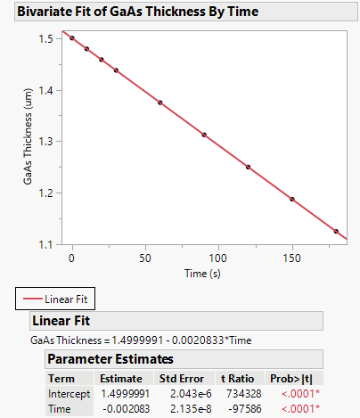
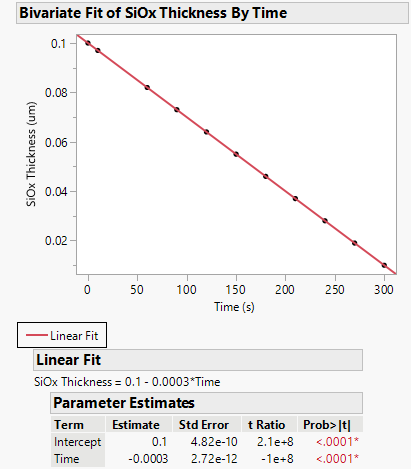
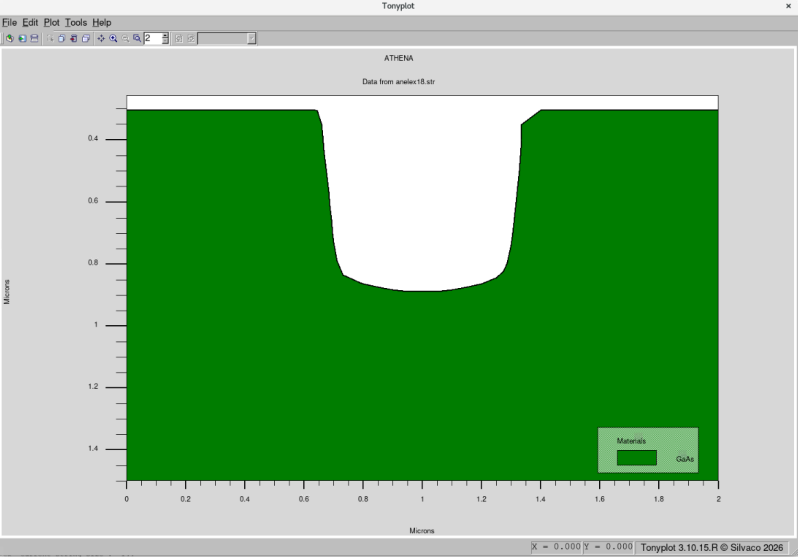
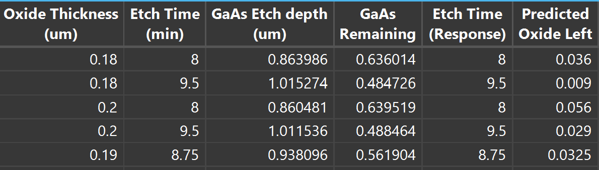
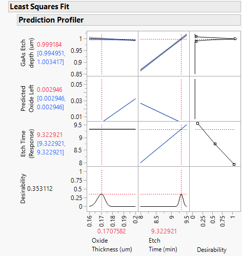
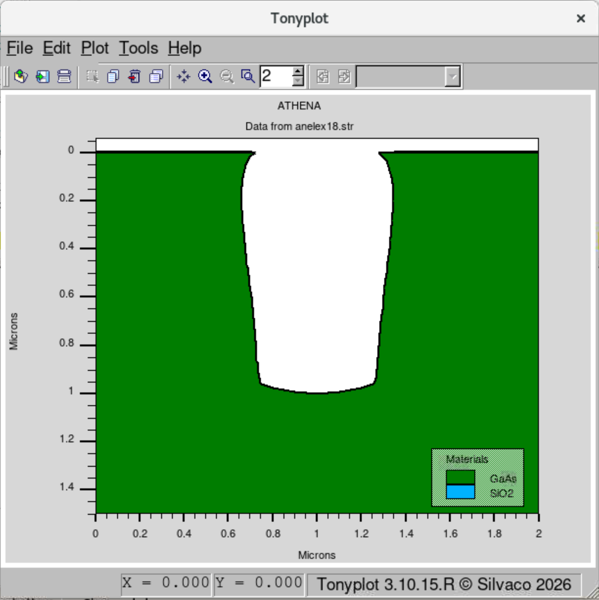
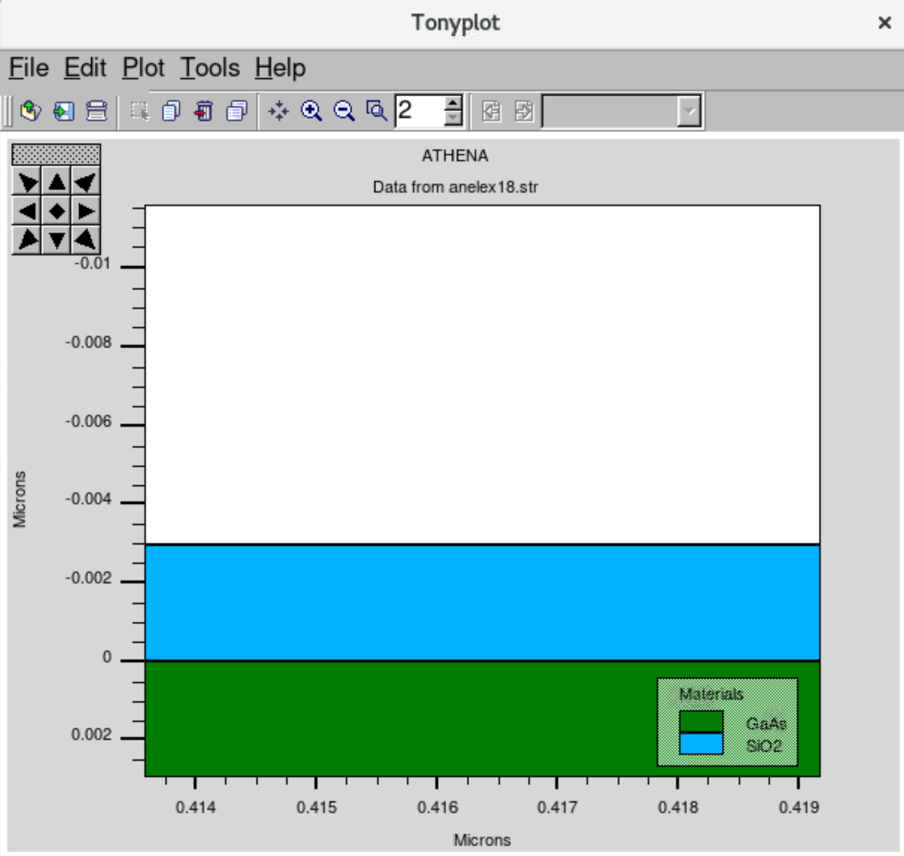

# GaAs RIE: Etch Selectivity and Mask Design

**Tool:** Athena · **Course / context:** EEE 435 (Microelectronics), ASU

## Goal

Etch a 0.5 µm wide trench 1 µm deep into GaAs by reactive ion etching (RIE) with an SiO₂ hard mask. I wanted the thinnest mask and shortest etch that reach the target depth without etching through the mask. That meant measuring the GaAs and SiO₂ etch rates, getting the selectivity from them, and then checking the hand calculation against the real trench geometry.

## Setup

The starting deck is based on Silvaco's `anelex18` Athena example: a GaAs substrate with a patterned oxide mask, etched by one RIE machine that has separate rate models for each material.

| Parameter | Value |
|---|---|
| Substrate | GaAs ⟨100⟩, 1.5 µm simulated depth |
| Domain / mesh | 2 µm wide, uniform 0.05 µm grid |
| Mask | SiO₂, 0.10 µm (baseline), with a 0.5 µm opening from x = 0.75 to 1.25 µm |
| RIE model, GaAs | chemical 35 nm/min, directional 90 nm/min, divergence 40° |
| RIE model, SiO₂ | chemical 3.0 nm/min, directional 15 nm/min, divergence 40° |
| Measurement | `extract ... thickness` at x = 1 µm (trench center) |

I measured etch rates on blanket films so the trench geometry wouldn't skew them. For GaAs I ran the deck with no oxide. For SiO₂ I deposited the oxide without patterning it. Each case was swept from 0 to 300 s and the remaining thickness was fit linearly in JMP.

## Results

**Blanket etch rates.** Both films etch at a constant rate, and the linear fits pass through every point:

| Material | Etch rate | |
|---|---|---|
| GaAs | 0.00208 µm/s (0.125 µm/min) |  |
| SiO₂ | 0.0003 µm/s (0.018 µm/min) |  |

That gives a **selectivity of 6.93 : 1** (GaAs : SiO₂). Etching 1 µm of GaAs should then need at least 1 / 6.93 = **0.144 µm** of oxide and about **8.0 min** of etch time.

**Overetching the baseline mask** ([`gaas_rie_8min.in`](deck/gaas_rie_8min.in)). The 0.10 µm baseline mask lasts only about 5.6 min. In an 8-minute run it disappears, and the GaAs field around the trench recesses by about 0.27 µm. The trench ends up shallower than intended and its top edges are rounded.

**The hand calculation falls short in the real trench.** With a mask at or above the 0.144 µm minimum, 8 minutes reached only about 0.86 µm of depth, about 14% short. GaAs inside the 0.5 µm opening etches more slowly than a blanket film because the divergence term shadows the trench sidewalls and floor. The mask is also eroded at an angle, not uniformly from the top. Blanket rates therefore overestimate the depth reached in a narrow feature.

**DOE to find the operating point** ([`gaas_rie_1um.in`](deck/gaas_rie_1um.in)). Instead of iterating by hand, I ran a small design of experiments in JMP. The two factors were oxide thickness (0.18–0.20 µm) and etch time (8–9.5 min), plus a center point. The responses were etch depth, remaining oxide and time. Etch time drove depth almost entirely, while oxide thickness had very little effect. I set the profiler to match 1 µm of depth, minimize time, and leave about 0.003 µm of oxide (roughly 10 s of etch margin).

The optimum was **0.171 µm of oxide and 9.32 min**. Rerunning the deck with those values gives exactly 0.5 µm of GaAs left at the trench center, which is 1.0 µm of depth. About 3 nm of oxide survives on the field.

Within the trench, the GaAs rate works out to 1 µm / 9.32 min ≈ 0.107 µm/min. The oxide consumed is about 0.168 µm, so the effective selectivity for this feature is about **6 : 1**, not the blanket value of 6.9.

## What I learned

- Etch rates from blanket films are a starting point, not an answer. In a feature this narrow (0.5 µm), the GaAs rate dropped by about 14%, and the mask needed to be about 20% thicker than the selectivity calculation predicted.
- When the mask runs out, the damage goes beyond a deeper etch: the field is etched as well, so the trench is shallower relative to the surface, and the profile is ruined.
- A two-factor DOE with a profiler found the operating point faster than guessing and rerunning. It also showed that oxide thickness mostly sets the margin, while time sets the depth.
- Next step: sweep the opening width to map how the effective rate depends on aspect ratio, so mask and time can be chosen from one lookup for any feature size.

## Files

| File | Purpose |
|---|---|
| [`deck/gaas_rie.in`](deck/gaas_rie.in) | Baseline: 0.10 µm mask, 1 min etch |
| [`deck/gaas_rie_8min.in`](deck/gaas_rie_8min.in) | 0.10 µm mask, 8 min etch: mask consumed |
| [`deck/gaas_rie_1um.in`](deck/gaas_rie_1um.in) | Optimized: 0.171 µm mask, 9.32 min, 1 µm deep trench |
| `plots/` | JMP rate fits, DOE results, and TonyPlot cross-sections |
