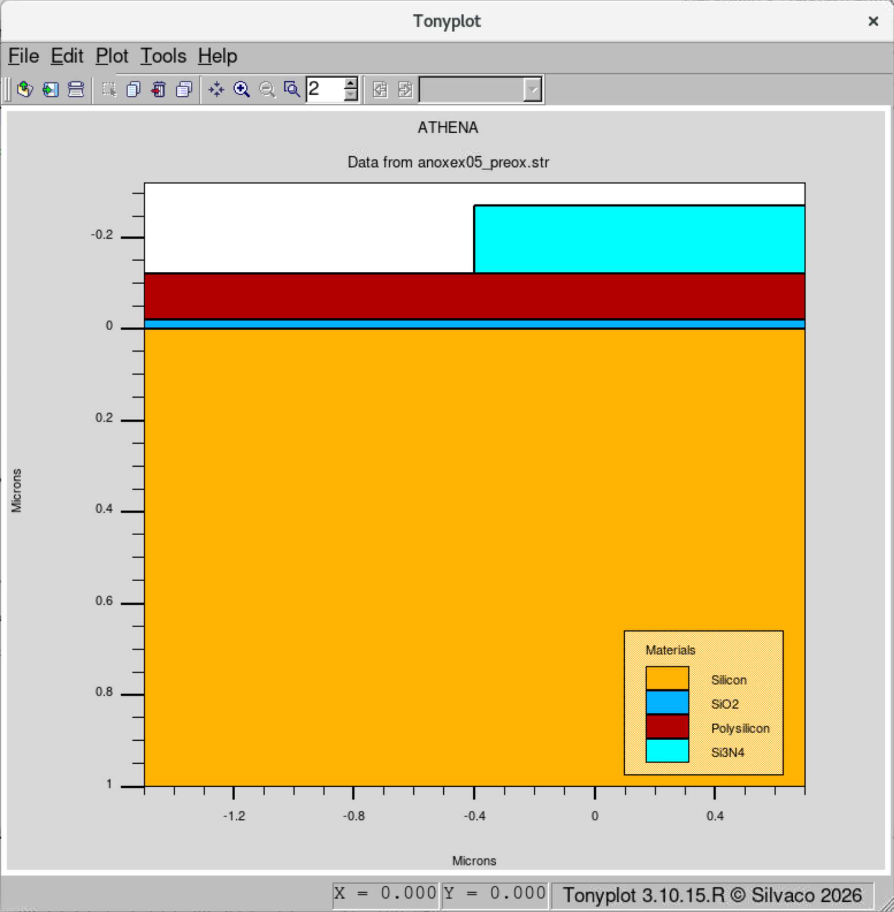
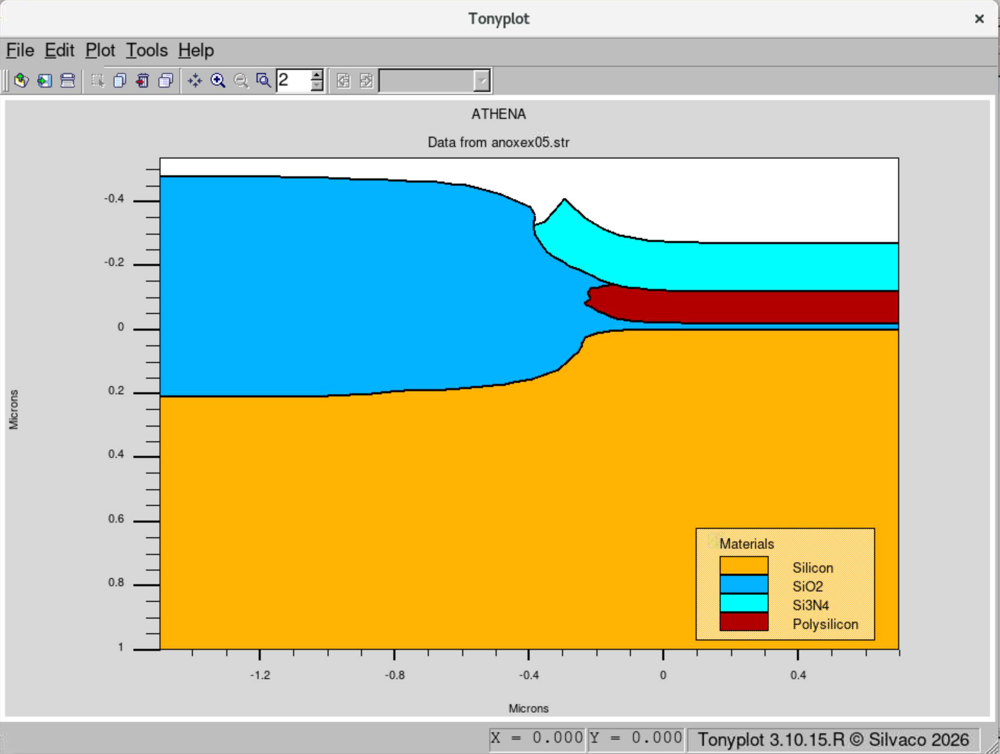

# Poly-Buffered LOCOS: Bird's Beak and Usable Active Width

**Tool:** Athena · **Course / context:** EEE 435 (Fundamentals of CMOS and MEMS Processing), ASU. Homework simulation based on Silvaco's `anoxex05` example (Athena_OXIDATION → Poly Buffered LOCOS). I added the `extract` step that measures how far the field oxide encroaches into the active region.

## Goal

LOCOS isolation grows a thick field oxide everywhere the nitride mask is removed, but oxide also grows sideways under the nitride edge (the bird's beak). This eats into the active region. Poly-buffered LOCOS (PBL) adds a polysilicon layer between the pad oxide and nitride to reduce that effect. The goal was to run the PBL process and find how much of the drawn active region is still usable after field oxidation.

## Setup

The simulation covers half of the active region: the right edge (x = 0.7 µm) is the center of the active area.

| Parameter | Value |
|---|---|
| Substrate | Si ⟨100⟩, x = −1.5 to 0.7 µm |
| Mesh | 0.02 µm laterally from x = −0.4 to 0 µm (mask edge), 0.1–0.2 µm elsewhere |
| Stack | 20 nm pad oxide / 100 nm poly-Si / 150 nm nitride |
| Mask | Nitride etched left of x = −0.4 µm |
| Field oxidation | Wet O₂, 1000 °C, 120 min (`method fermi compress`) |
| Added measurement | Lateral SiO₂ extent at y = 0.021 µm (`extract ... thickness material="SiO~2" y.val=0.021`) |

## Results

**Before oxidation.** The nitride defines the active region from x = −0.4 to 0.7 µm, or 1.1 µm for the half-cell. The drawn active length is therefore **2 × 1.1 = 2.2 µm**.



**After oxidation.** The field oxide grows under the mask edge and lifts the nitride. The poly-Si layer is partly oxidized at its edge.



**Usable active length.** If the pad oxide can grow by no more than 5%, the active region ends where the oxide is thicker than 0.02 × 1.05 = 0.021 µm. Extracting the SiO₂ extent at y = 0.021 µm gives 1.27598 µm, measured from the left edge of the 2.2 µm wide simulation.

```
Usable length = (total width − oxide extent) × 2
              = ((1.5 + 0.7) − 1.276) × 2
              ≈ 1.85 µm
```

| | Length |
|---|---|
| Drawn active region (nitride) | 2.2 µm |
| Usable after wet oxidation (≤ 5% pad-oxide growth) | 1.85 µm |

**Role of the poly-Si layer.** The poly-Si layer releases stress in the stack. Oxidizing the silicon makes the nitride layer bend, and the poly interlayer keeps it from breaking under that stress.

## Files

| File | Purpose |
|---|---|
| [`deck/anoxex05.in`](deck/anoxex05.in) | DeckBuild input deck (Silvaco example with the added `extract` line) |
| `plots/` | TonyPlot cross-sections before and after field oxidation |
