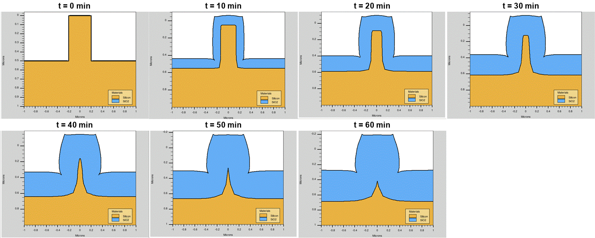
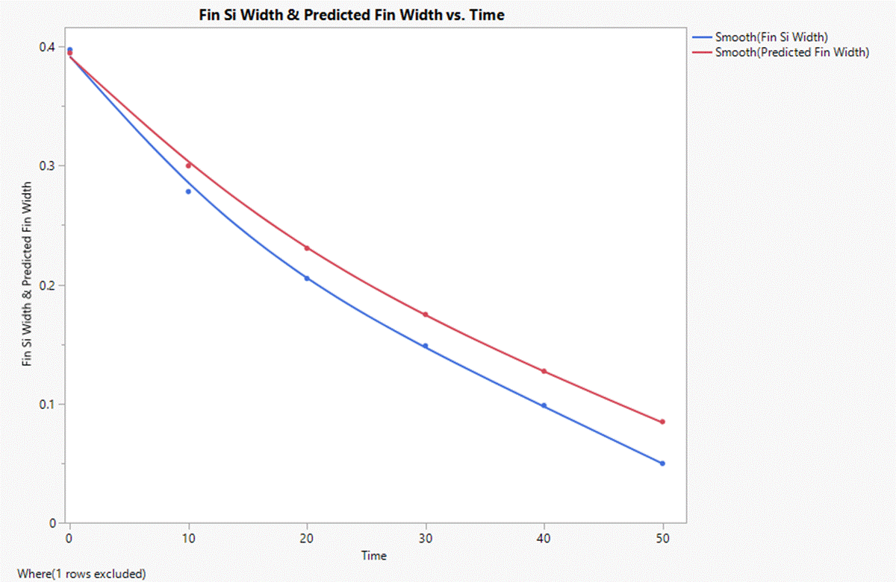

# Thermal Oxidation of an Etched Si Fin

**Tool:** Athena · **Course / context:** EEE 435 (Fundamentals of CMOS and MEMS Processing), ASU. This was a group lab. This writeup covers my part: the 2D fin oxidation simulations and the dimensional-control analysis.

## Goal

The 1D Deal–Grove model predicts oxide growth on a flat wafer. I wanted to see how well it describes a 3D-ish feature: a 0.4 µm wide silicon fin oxidized from the top and both sidewalls at once. I also wanted to know whether thermal oxidation can be used on purpose to trim or grow a structure's width.

## Setup

The deck is adapted from the course's example trench-oxidation deck and was run in DeckBuild on the school's Linux servers.

| Parameter | Value |
|---|---|
| Substrate | p-type Si ⟨100⟩, boron, 10 Ω·cm |
| Fin | 0.4 µm wide (x = −0.2 to 0.2 µm), 0.5 µm tall, made by etching the Si on either side |
| Mesh | 0.02 µm laterally across the fin, 0.10 µm in the field, 0.05 µm vertically |
| Pre-oxidation | Dry O₂, 800 °C, 30 min (~3 nm, roughly a native oxide) |
| Wet oxidation | 1000 °C, H₂O:N₂ = 450:6, 1 atm, **swept 0–60 min in 10 min steps** |
| Measurements | Oxide thickness at x = 0.5 µm (flat field); Si fin width at y = 0.4 µm |

## Results

As oxidation goes on, the fin narrows and the oxide cap grows outward. By 60 minutes the silicon at the measurement height is fully consumed and only a pointed stub remains lower down.



**Planar prediction vs. simulation.** Thermal oxidation consumes about 0.44 µm of Si per 1 µm of SiO₂ grown. Using the oxide thickness on the flat field, a planar model predicts:

```
Si consumed per side   = 0.44 × t_ox
Predicted fin width    = 0.3973 − 2 × (Si consumed per side)
```

| Wet ox time (min) | Field oxide (µm) | Simulated fin width (µm) | Planar prediction (µm) | Error |
|---|---|---|---|---|
| 0  | 0.0032 | 0.3973 | 0.3945 | +0.7% |
| 10 | 0.1109 | 0.2782 | 0.2998 | −7.2% |
| 20 | 0.1896 | 0.2052 | 0.2305 | −11.0% |
| 30 | 0.2527 | 0.1486 | 0.1749 | −15.0% |
| 40 | 0.3069 | 0.0985 | 0.1273 | −22.6% |
| 50 | 0.3551 | 0.0498 | 0.0848 | −41.3% |
| 60 | 0.3996 | 0.0000 | 0.0456 | −100% (pinched off) |



In the simulation the fin always narrows faster than the planar model predicts, and the gap widens over time. Near the top of the fin, oxidant reaches the silicon from the top and both sidewalls. That converging oxidation tapers the fin to a point instead of thinning it evenly. The planar model treats each sidewall as an independent flat surface, so it misses this effect.

**Using oxidation for dimensional control.** The same process can move a feature's width in either direction:

- **Thinning:** Oxidize, then strip the oxide in HF, which removes SiO₂ but not Si. Under these conditions, about 20 minutes takes the fin from 400 nm to about 200 nm of silicon.
- **Widening:** Oxidize and keep the oxide. About 56% of the oxide thickness grows outward past the original surface. Adding 100 nm per side therefore takes about 180 nm of oxide, which is also about 20 minutes here. The result is a fin about 600 nm wide: a silicon core inside an oxide shell.

## What I learned

- 1D Deal–Grove numbers are a good first estimate for flat areas (on real furnace data the fit held to about 2%; see [Wet Thermal Oxidation: Deal–Grove Fit](../../semiconductor-characterization/thermal-oxidation-deal-grove)) but get steadily worse on narrow features. For this fin the error passed 20% after 40 minutes. Anything sub-micron with exposed sidewalls needs a 2D simulation.
- Where you measure matters. The fin goes from rectangular to tapered, so a single width extracted at one height doesn't fully describe the profile.
- Oxidation followed by an HF strip is a simple way to trim features below the lithography limit, the same idea as sacrificial oxidation in FinFET processing. The trade-off is that the fin tapers instead of shrinking evenly.
- Next step: extract the width at several heights to measure the taper, and try a lower temperature or dry oxidation to see whether slower growth keeps the sidewalls straighter.

## Files

| File | Purpose |
|---|---|
| [`deck/fin_wet_oxidation.in`](deck/fin_wet_oxidation.in) | DeckBuild input deck. Change `time=` on the wet `diffus` line to reproduce each point. |
| `plots/` | TonyPlot cross-sections (time series) and the JMP width comparison |
